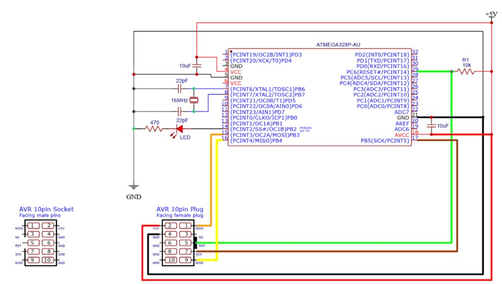
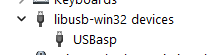

# ENIT AVR Studio

> **Professional Microcontroller Programmer & Hardware Diagnostic Platform**  
> **Copyright &copy; 2026 Aries Computer Solutions &bull; Harshad Patel, India. All Rights Reserved.**

[](https://github.com/arieslaptop/ENIT-AVR-Studio)
[](https://python.org)
[](https://qt.io)
[](https://fischl.de/usbasp/)
[](http://www.arieslaptop.in)
[](https://www.youtube.com/harshadpatel)
[](https://www.facebook.com/aries.harshadpatel)
[](https://paypal.me/ariestech)

---

## 🌟 Overview

**ENIT AVR Studio** is a modern, high-performance open-source Windows application designed for flashing, testing, and diagnosing Microchip/Atmel AVR 8-bit microcontrollers via **USBasp ISP programmers**. Built with an industrial cyber-dark aesthetic and Google Stitch design tokens, it offers superior reliability, non-blocking telemetry, intelligent page-skipping flash algorithms, comprehensive fuse configuration, and an interactive ZIF socket placement guide.

### 🆕 What's New in v1.0.1 (Bug Fix Release — Recommended for All Users)
> **Important Update for Existing Users**: If you downloaded `v1.0`, please upgrade to **`v1.0.1`**!
- **Strict Post-Write Verification vs Original PC File**: Every Flash write (`Write Flash` and `Write All`) now automatically reads back the chip's Flash memory and performs a 100% byte-for-byte comparison directly against the original `.hex` file on your PC before reporting `Verify OK`. Any mismatch immediately halts and reports the exact failing address.
- **USBasp Address-Shift & Bootloader Fix (ATmega328P)**: Fixed sparse `.hex` programming (e.g., application + `0x7800` bootloader) so sequential `prog_address` never shifts on USBasp firmware clones, with upgraded `5000ms` USB transfer stability.
- **ZIF Socket Hot-Swap Auto-Sync**: Every hardware operation (`Read Fuses`, `Write Fuses`, `Read All`, `Write All`, `Chip Erase`) now automatically re-syncs the currently inserted IC and safely releases `RESET` afterward — program 100+ ICs continuously without clicking Disconnect/Connect or Auto-Detect between chips.
- **Standard Intel HEX Export Fix**: Fixed `.hex` file export so saved dumps skip `0xFF` blank lines and omit redundant `04` extended linear records for `< 64KB` MCUs (like ATmega328P), producing 100% byte-identical files in HxD Hex Editor compared to `avr-gcc` and eXtreme Burner.
- **Clean Buffer Reload**: Loading a new `.hex` file now resets the memory buffer cleanly to `0xFF` first so previous bytes never persist.

---

## ⚡ Key Features

- **🚀 Ultra-Fast Flashing Engine**:
  - Implements intelligent **0xFF blank page skipping**, eliminating redundant flash writes and boosting overall programming speed by up to 60–80%.
  - High-throughput USBasp bulk transfer pipe with automatic SCK frequency auto-tuning.
- **🛡️ 100% Bit-Exact Verification**:
  - Real-time post-write verification against Intel HEX buffers with byte-level discrepancy reporting and CRC32 telemetry integrity validation.
- **🔧 Advanced Fuse & Lock Bits Manager**:
  - Visual bit-by-bit manipulation of Low, High, Extended, and Lock fuse bytes.
  - Interactive **Fuse Details Dialog** with individual bit names (BODLEVEL, EESAVE, BOOTSZ, SPIEN, CKDIV8, etc.).
  - Built-in safety warnings to prevent accidental bricking or lockout.
  - One-click **Reset Fuses to Chip Defaults** feature.
- **⏱️ Interactive AVR Clock Generator**:
  - Clock frequency calculator with visual clock source selectors:
    - Internal Calibrated RC Oscillators (128 kHz, 1 MHz, 4 MHz, 8 MHz)
    - Low-Frequency Crystal Oscillators (32.768 kHz RTC)
    - Full-Swing and Low-Power External Ceramic/Quartz Crystals (up to 16+ MHz)
- **📚 Universal AVR Chip Database**:
  - Built-in comprehensive library covering 50+ AVR microcontrollers including:
    - **ATmega Series**: ATmega328P, ATmega328PB, ATmega16, ATmega32, ATmega8, ATmega8A, ATmega168P, ATmega88P, ATmega64, ATmega128, etc.
    - **ATtiny Series**: ATtiny85, ATtiny45, ATtiny13, ATtiny2313, ATtiny44, ATtiny84, etc.
    - **AT90S / Legacy Series**: AT90S8515, AT90S2313, etc.
- **🔌 ZIF Socket Placement Guide**:
  - Interactive visual pinout guidance showing exact IC insertion alignment in standard ZIF sockets for 28-pin DIP, 40-pin DIP, 20-pin DIP, and 8-pin DIP packages.
- **📊 Real-Time Telemetry HUD**:
  - Non-blocking multi-threaded architecture with dynamic status ribbon:
  - Throughput meter (B/s), Elapsed timer, ETA countdown, and live hardware log feed.
- **💻 Dual-Mode Architecture**:
  - **Full GUI Mode**: Standalone Windows application (`enit_avr_studio_gui.py` / `ENIT_AVR_Studio.exe`).
  - **Headless CLI Mode**: Command-line tool (`enit_avr_cli.py`) for automated factory flashing, testing rigs, and CI/CD pipelines.

---

## 📐 Hardware Connection & Schematic Guide

ENIT AVR Studio connects to target AVR microcontrollers via the standard **10-pin AVR ISP header** found on USBasp programmers.

### Circuit Schematic: USBasp to ATmega328P



### Standard 10-Pin AVR ISP Header Pinout

```text
       AVR 10-Pin ISP Socket (Facing Male Pins / Female Plug)
                 +-----------+
    MOSI (Pin 1) | [1]   [2] | VCC (+5V)
      NC (Pin 3) | [3]   [4] | GND
   RESET (Pin 5) | [5]   [6] | GND
     SCK (Pin 7) | [7]   [8] | GND
    MISO (Pin 9) | [9]  [10] | GND
                 +-----------+
```

### Connection Table: USBasp to ATmega328P

| USBasp 10-Pin Header | Signal Name | Wire Color (Ref) | ATmega328P-AU (32-Pin TQFP) | ATmega328P (28-Pin DIP) | Function Description |
|:---:|:---:|:---:|:---:|:---:|:---|
| **Pin 1** | **MOSI** | Orange | Pin 15 (`PB3` / MOSI) | Pin 17 (`PB3` / MOSI) | Master Out Slave In |
| **Pin 2** | **VCC** | Red | Pin 4, 6 (`VCC`), Pin 18 (`AVCC`) | Pin 7 (`VCC`), Pin 20 (`AVCC`) | +5.0V Target Power Rail |
| **Pin 3** | **NC** | - | Not Connected | Not Connected | No Connection |
| **Pin 4, 6, 8, 10** | **GND** | Black | Pin 3, 5, 21 (`GND`) | Pin 8, 22 (`GND`) | Common Ground Return |
| **Pin 5** | **RESET** | Green | Pin 29 (`PC6` / RESET#) | Pin 1 (`PC6` / RESET#) | Active-Low ISP Reset line (10k pull-up to +5V) |
| **Pin 7** | **SCK** | Brown | Pin 17 (`PB5` / SCK) | Pin 19 (`PB5` / SCK) | Serial Programming Clock |
| **Pin 9** | **MISO** | Yellow | Pin 16 (`PB4` / MISO) | Pin 18 (`PB4` / MISO) | Master In Slave Out |

### Recommended External Components for Flashing Circuit
1. **Pull-up Resistor**: 10 kΩ resistor between `RESET` and `VCC` (+5V) to prevent spurious resets during operation.
2. **Decoupling Capacitors**: 10 µF electrolytic or ceramic capacitor across `VCC` and `GND`, and 10 µF on `AREF` to `GND`.
3. **Crystal Oscillator**: 16.000 MHz quartz crystal connected between `XTAL1` (Pin 7/PB6 on TQFP, Pin 9 on DIP) and `XTAL2` (Pin 8/PB7 on TQFP, Pin 10 on DIP), with two 22 pF ceramic load capacitors to GND.
4. **Status LED** (optional): Connected to Pin 14 (TQFP Pin 14 / DIP Pin 16) through a 470 Ω current-limiting resistor to GND.

---

## 💖 Support & Sponsorship (Open Source Community)

ENIT AVR Studio is maintained and actively developed as free, open-source software by **Aries Computer Solutions**, founded by **Harshad Patel in India**. 

Your sponsorships help acquire test hardware, fund new microcontroller protocol development, and keep these tools open and accessible to all developers:

- ☕ **[$10 USD Sponsorship](https://paypal.me/ariestech/10USD)**: Fund coffee, test cables, and server bandwidth.
- 🚀 **[$20 USD Sponsorship](https://paypal.me/ariestech/20USD)**: Sponsor new AVR microcontroller sample chips and test adapters.
- ✨ **[Custom Sponsorship Amount](https://paypal.me/ariestech)**: Any contribution via PayPal.Me is deeply appreciated!

**GitHub Repository**: [https://github.com/arieslaptop/ENIT-AVR-Studio](https://github.com/arieslaptop/ENIT-AVR-Studio)

---

## 🛠️ USBasp Driver Installation (Zadig Setup Guide)

Before using ENIT AVR Studio on Windows, your **USBasp** programmer must use the **`libusb-win32`** (`libusb0`) driver. Follow these steps using **Zadig**:

1. Plug your **USBasp** programmer into a USB port on your Windows PC.
2. Download and run **Zadig** from the official website: **[https://zadig.akeo.ie/](https://zadig.akeo.ie/)**
3. In Zadig, click the top menu **Options &rarr; List All Devices**.
4. From the main dropdown list, select **`USBasp`** *(USB ID: `16C0 : 05DC`)*.
5. In the target driver box (to the right of the green arrow), click the up/down arrows and select **`libusb-win32`** *(do **not** select WinUSB or libusbK)*.
6. Click **Install Driver** (or **Replace Driver**) and wait for Windows to complete installation.
7. Open **Windows Device Manager** and confirm **`USBasp`** appears under **`libusb-win32 devices`**:



---

## 🚀 Quick Start & Installation

### Option 1: Standalone Windows Executable (No Python Required)
1. Install the **`libusb-win32`** driver for USBasp using **Zadig** (see steps above).
2. Download the latest `ENIT_AVR_Studio.exe` or `ENIT_AVR_Studio_v1.0.1_Windows_x64.zip` from the [Releases](https://github.com/arieslaptop/ENIT-AVR-Studio/releases) page.
3. Double-click `ENIT_AVR_Studio.exe` to launch immediately.

### Option 2: Running from Source (Python 3.10+)
```powershell
# 1. Clone repository
git clone https://github.com/arieslaptop/ENIT-AVR-Studio.git
cd ENIT-AVR-Studio

# 2. Install dependencies
pip install PySide6 pyusb

# 3. Launch application
python enit_avr_studio_gui.py
```

Or double-click `run_enit_avr_studio.bat`.

---

## 💻 CLI Tool Usage (`enit_avr_cli.py`)

For automated workflows, test rigs, and terminal automation:

```powershell
# Auto-detect target chip and verify connection
python enit_avr_cli.py --detect

# Read Fuse and Lock bits
python enit_avr_cli.py -c ATmega328P --read-fuses

# Flash firmware HEX file with verification
python enit_avr_cli.py -c ATmega328P -wf myFirmware.hex -vf myFirmware.hex

# Complete Write-All (Erase, Flash, EEPROM, and Fuses in one go)
python enit_avr_cli.py -c ATmega328P -wf myFirmware.hex -we myEEPROM.eep -wF FF:DE:FD:FF --write-all
```

---

## 📸 Application Screenshots & UI Showcase

<p align="center">
  <br/>
  <em>Figure 1: Main Application Workspace, Live HEX Memory Grid & High-Speed Hardware Controls</em>
</p>

<p align="center">
  <br/>
  <em>Figure 2: Visual Fuse & Lock Bits Manager with Safety Verification</em>
</p>

<p align="center">
  <br/>
  <em>Figure 3: Interactive AVR Clock Generator & Frequency Presets</em>
</p>

<p align="center">
  <br/>
  <em>Figure 4: ZIF Socket Placement Guide & DIP IC Pin Alignment</em>
</p>

<p align="center">
  <br/>
  <em>Figure 5: Support Open Source Development & Community Contribution Modal</em>
</p>

---

## 📁 Repository Structure

```text
ENIT-AVR-Studio/
├── .github/
│   └── FUNDING.yml             # GitHub Sponsors / PayPal.Me sponsorship config
├── Data/                       # Complete AVR chip database & fuse layouts XML
│   ├── chips.xml
│   └── fuselayout.xml
├── Icons/                      # Complete Windows .ico and .png icon suite (16x16 to 256x256)
│   └── enit_avr_studio.ico
├── Images/                     # UI visual assets, branding, and diagrams
│   ├── enit_logo.png           # Master clean ENIT 3D chip logo
│   ├── enit_logo_header.png    # Header rounded HUD logo
│   ├── Placements/             # ZIF socket placement diagrams
│   └── Schematics/             # Hardware connection schematics
│       └── usbasp_atmega328p_isp_schematic.png
├── enit_avr_studio_gui.py      # Main PySide6 GUI Application
├── enit_avr_core.py            # High-speed USBasp driver & ISP programming engine
├── enit_chip_db.py             # Chip signatures, memory configurations & fuse models
├── enit_hex_parser.py          # Fast Intel HEX & Motorola S-record parser
├── enit_avr_cli.py             # Production CLI automation tool
├── push_to_github.bat          # One-click repository push helper
├── run_enit_avr_studio.bat     # Windows one-click launcher
├── DESIGN.md                   # Google Stitch Design System documentation
├── APPLICATION_ARCHITECTURE.md # System architecture specification
├── SECURITY_CHECKLIST.md       # Windows security & code signing guidelines
├── TESTING_REPORT.md           # Hardware flash verification logs (ATmega328P 100% pass)
└── README.md                   # Project overview & hardware schematic guide
```

---

## 🌐 Connect & Social Media (Aries Computer Solutions)

| Platform | Official Link / Handle | Details |
|:---|:---|:---|
| 🏢 **Company** | **Aries Computer Solutions** | Professional IT solutions, hardware diagnostics & tools |
| 👤 **Founder & Engineer** | **Harshad Patel** | System Architect & Hardware Engineer, India |
| 🌍 **Official Website** | [www.arieslaptop.in](http://www.arieslaptop.in) | Company portal, services & products |
| 📺 **YouTube Channel** | [youtube.com/harshadpatel](https://www.youtube.com/harshadpatel) | Video guides, technical tutorials & repair demos |
| 📘 **Facebook** | [facebook.com/aries.harshadpatel](https://www.facebook.com/aries.harshadpatel) | Official community page & updates |
| 🐙 **GitHub** | [github.com/arieslaptop](https://github.com/arieslaptop) | Open-source software repositories |
| 💖 **PayPal Sponsorship** | [paypal.me/ariestech](https://paypal.me/ariestech) | Direct community development contributions |

---

## 📜 Copyright & License

Copyright &copy; 2026 **Aries Computer Solutions**  
Author: **Harshad Patel, India**  
All Rights Reserved.

Open source software distributed under the MIT License. Contributions, feedback, and pull requests are warmly welcomed!
